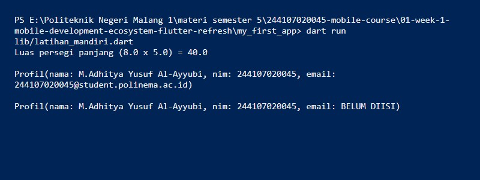
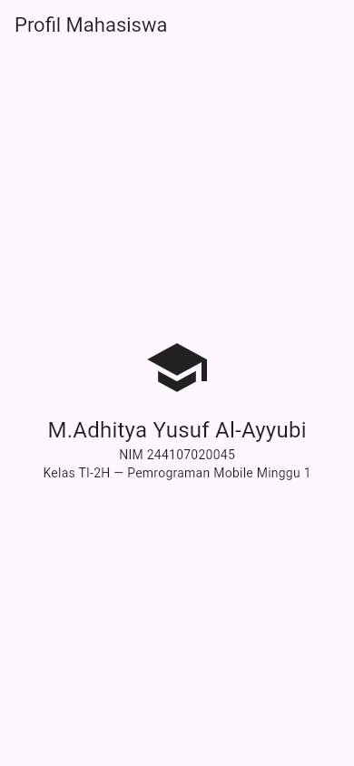
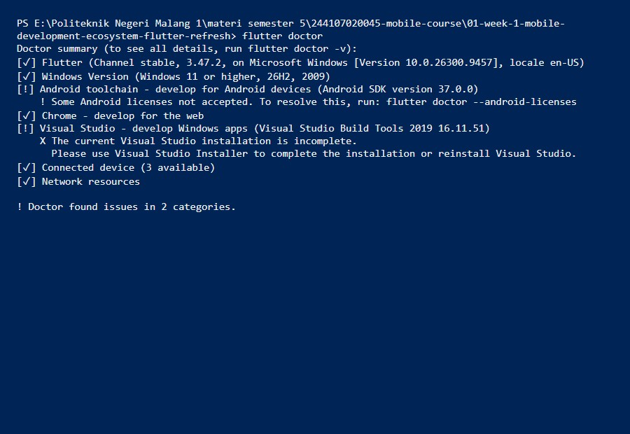
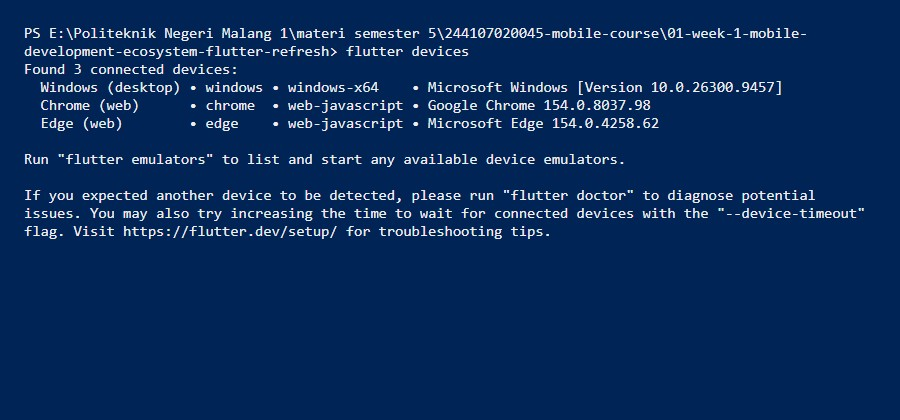

# Minggu 1 — Ekosistem Mobile & Refresh Flutter

Praktikum pembuka: menyiapkan environment, mengulang dasar Dart, dan
membuat aplikasi Flutter pertama (profil mahasiswa).

**M.Adhitya Yusuf Al-Ayyubi · NIM 244107020045 · TI-2H**

## Yang saya kerjakan

1. **Latihan mandiri Dart** — fungsi `hitungLuasPersegiPanjang`, kelas
   `Profil` (`nama`, `nim`, `email` yang boleh null/empty), dan penanganan
   email kosong yang aman (pakai `?.` + nilai default, tanpa operator `!`).
   Kode: [`my_first_app/lib/latihan_mandiri.dart`](my_first_app/lib/latihan_mandiri.dart),
   dijalankan dengan `dart run lib/latihan_mandiri.dart`.

   

2. **Praktikum: aplikasi profil** — mengikuti kode codelab, dijalankan di
   Chrome viewport mobile 390x844.
   Kode: [`my_first_app/lib/main.dart`](my_first_app/lib/main.dart).

   

3. **Mini assignment** — profil mahasiswa + NIM + info tambahan (kelas TI-2H)
   dengan widget dasar.

   

## Bukti environment

`flutter doctor` tidak punya masalah yang menghambat target Android
(ada 2 issue minor yang tidak terkait target web/Chrome — lihat Kendala).



`flutter devices` mendeteksi emulator/perangkat fisik:



## Hot reload vs hot restart

**Hot reload** memuat ulang perubahan kode ke aplikasi yang sedang berjalan
tanpa mengulang dari awal — cepat untuk iterasi UI, state tetap terjaga.

**Hot restart** menghentikan dan menjalankan ulang aplikasi dari awal —
lebih lambat, dipakai saat perubahan besar memengaruhi state, butuh
inisialisasi ulang, atau ada error fatal.

## Menjalankan

```bash
cd my_first_app
flutter pub get
flutter run -d chrome
```

Latihan mandiri (dari dalam `my_first_app/`):

```bash
dart run lib/latihan_mandiri.dart
```

## Kendala setup

- `flutter doctor`: Android licenses belum diterima
  (`flutter doctor --android-licenses`) dan instalasi Visual Studio Build
  Tools tidak lengkap. Keduanya tidak menghambat target Chrome/web yang
  dipakai di sini; Chrome dan Edge terdeteksi di `flutter devices`.
- Android Studio sempat tidak mengenali Flutter sebagai target Android;
  selesai setelah memastikan Android SDK, Command-line Tools, dan emulator
  terpasang via SDK/Device Manager.

## Refleksi

**Kapan native lebih tepat daripada cross-platform?**
Native lebih tepat ketika aplikasi menuntut performa tinggi atau optimasi
khusus pada perangkat tertentu, karena cross-platform kurang optimal di
situ — walau cross-platform menang saat harus merilis ke banyak platform
tanpa menulis banyak bahasa native.

**Bagaimana state berhubungan dengan widget tree dan UI deklaratif?**
State menentukan data yang sedang dipakai. Saat state berubah, widget tree
dibangun ulang secara deklaratif sehingga tampilan menyesuaikan data terbaru
tanpa mengubah UI satu per satu.

**Mengapa commit kecil berpesan jelas bermanfaat?**
Commit kecil memudahkan tim melihat perubahan spesifik, meminimalkan konflik,
dan mempermudah koordinasi. Untuk portfolio, riwayat yang rapi menunjukkan
proses belajar dan kerja yang profesional.
