# Minggu 2 — UI Deklaratif & Layout Responsif

Dashboard akademik sederhana di Flutter: header profil + kartu informasi,
satu kolom di layar sempit dan dua kolom di layar lebar, plus ganti
light/dark theme.

**M.Adhitya Yusuf Al-Ayyubi · NIM 244107020045 · TI-2H · Politeknik Negeri Malang**

## Target saya minggu ini

Menyusun tampilan dari `Row`, `Column`, `Container`, dan `Expanded`;
membuat layout yang rapi di layar sempit maupun lebar; menampilkan empat
kartu akademik; toggle light/dark theme lewat `CupertinoSwitch`; memberi
label `Semantics` agar screen reader bisa membaca info penting;
membandingkan `GridView` dengan `LayoutBuilder + Column`; memahami cara
mencegah overflow di `Row`/`Expanded`; dan menguji semuanya di beberapa
ukuran layar.

## Pemanasan: layout sederhana

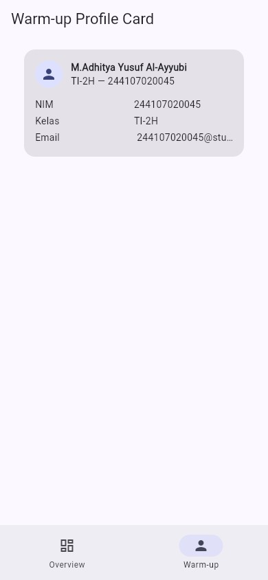

Tiga eksperimen kecil dan pelajarannya:

**Eksperimen Expanded.**
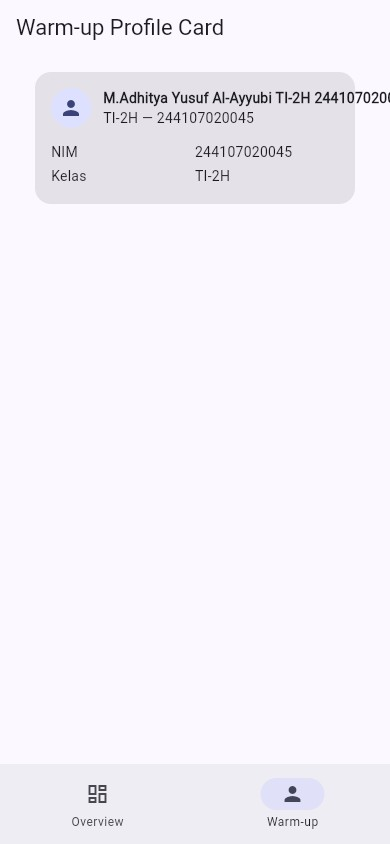
`Expanded` pada kolom nama saya hapus: teks panjang menabrak batas kartu dan
terpotong (overflow). Setelah dikembalikan, `Row` bisa membagi ruang dengan
benar.

**Eksperimen main axis.**
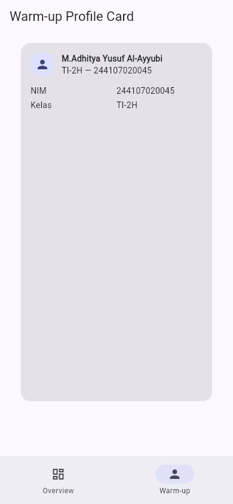
`mainAxisSize` saya ganti dari `min` ke `max`: kartu meregang setinggi ruang
yang tersedia dan terlihat kosong di bawah. Saya kembalikan ke `min` agar
kartu hanya setinggi isinya.

**Eksperimen baris email.**
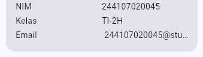
Baris Email saya tambah dengan pola `Row` + `Expanded` yang sama. Email
panjang dibungkus `Flexible` + `TextOverflow.ellipsis` sehingga terpotong
rapi (`...`), bukan overflow.

## Dashboard responsif

**Profil + switch tema.**
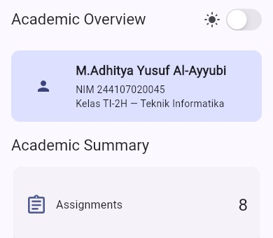

**Layar lebar.**
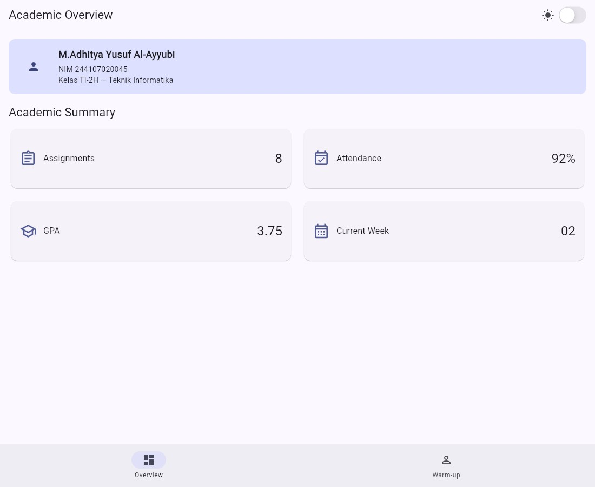

Hal yang saya putuskan saat mengerjakan:

- **Breakpoint** — satu konstanta `kWideBreakpoint = 700` di `lib/main.dart`.
  Di bawah 700 tampil satu kolom, 700 ke atas tampil dua kolom.
- **Mode tema** — state `isDark` dikontrol `CupertinoSwitch` di `AppBar`
  (komponen Cupertino di dalam `MaterialApp`). Mode gelap tetap terbaca
  dengan kontras yang baik:

  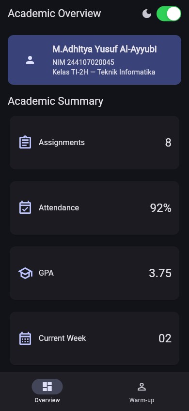

- **Ukuran layar** — diuji lewat widget test (`400x900` vs `1200x900`) dan
  screenshot browser (390px vs 1100px).
- **Semantics** — label aksesibilitas di header profil, tiap kartu
  (`Assignments: 8`, dst.), dan switch tema (`Mode gelap/terang aktif`).

## Hasil akhir: Academic Overview

Halaman **Academic Overview** menampilkan header profil (nama, NIM, kelas)
dan empat kartu: Assignments, Attendance, GPA, Current Week.

**Tampilan sempit (satu kolom).**
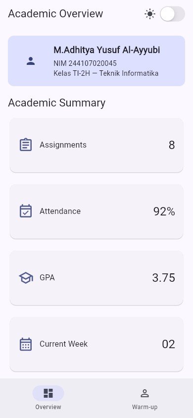

**Tampilan lebar (dua kolom).**


Screenshot diambil dari aplikasi yang dijalankan di **Chrome (web) viewport
mobile 390x844** memakai skrip `screenshots/take_screenshots.py`
(Playwright + Chrome headless atas hasil `flutter build web`).

**Hasil test — semua lolos.**
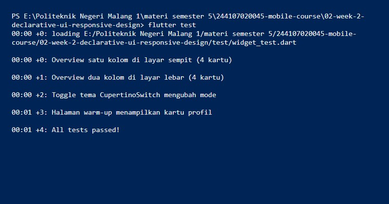

**Hasil analyze — bersih.**
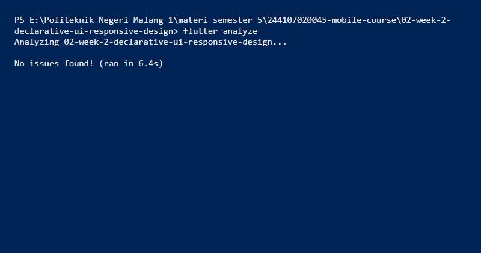

## AI Prompt Challenge (sesudah implementasi mandiri)

**Prompt desain + keputusan saya.**
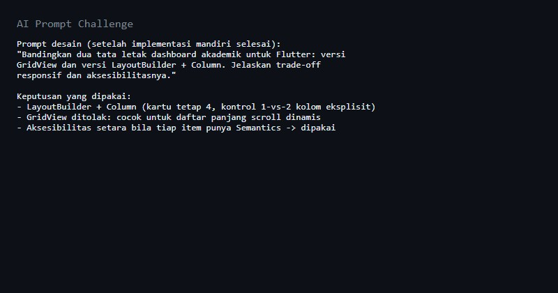

**Bukti verifikasi.**
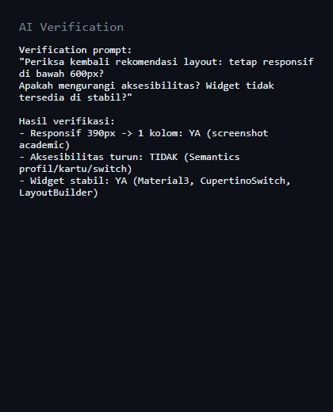

1. *Prompt desain* — "Bandingkan `GridView` vs `LayoutBuilder` + `Column`
   untuk dashboard akademik (trade-off responsif dan aksesibilitas)."
   Keputusan saya: `LayoutBuilder` + `Column`, karena kartunya tetap 4 dan
   saya butuh kontrol eksplisit 1-vs-2 kolom.
2. *Prompt penguatan konsep* — "Kapan `Expanded` menyebabkan overflow di
   `Row`, contoh gagal + perbaikan." Saya verifikasi langsung lewat
   eksperimen di atas.
3. *Verification prompt* — responsif di bawah 600px (terbukti di 390px,
   1 kolom), aksesibilitas tidak turun, semua widget dari Flutter stabil.

## Refactoring yang saya lakukan

- Kartu diekstrak jadi widget reusable `AcademicCard(title, value, icon)`
  dan baris info jadi `InfoRow(label, value)` — tanpa duplikasi.
- Warna/ukuran mengikuti `Theme.of(context)` agar otomatis ikut light/dark.
- Breakpoint satu konstanta `kWideBreakpoint = 700`.
- `flutter analyze` bersih, tanpa error/warning baru.

## Menjalankan

```bash
cd 02-week-2-declarative-ui-responsive-design
flutter pub get
flutter analyze
flutter test
flutter run -d chrome   # buka tab Overview & Warm-up
```

Membuat ulang screenshot:

```bash
flutter build web --release
python screenshots/take_screenshots.py
```

## Refleksi

**Imperative vs declarative?**
Imperative memberi perintah satu per satu — kapan tampilan dibuat atau
diubah. Declarative fokus pada hasil tampilan dari suatu kondisi: di
Flutter, saat state berubah tampilan menyesuaikan otomatis. Contohnya saat
`isDark` berubah, tema ikut berubah tanpa saya menyentuh tiap kartu.

**Kapan `Expanded` membantu, kapan bermasalah?**
`Expanded` membantu di dalam `Row`/`Column` untuk membagi ruang — di
dashboard ini ia menjaga judul kartu tidak tembus layar. Ia bermasalah saat
ruangnya tidak punya batas jelas (misal `Row` di dalam scroll horizontal)
atau saat widget lain berukuran tetap terlalu besar.

**Pengaruh breakpoint dan theme?**
Breakpoint mengatur susunan layout per ukuran layar: sempit satu kolom,
lebar dua kolom, supaya kartu tetap terbaca dan tidak sempit. Theme soal
kenyamanan: light untuk terang, dark untuk gelap — teks dan latar harus
tetap kontras di keduanya.

**Verifikasi rekomendasi AI?**
Setelah tugas utama selesai saya membandingkan `GridView` dengan
`LayoutBuilder + Column` di layar sempit dan lebar, memeriksa overflow
`Expanded`, mencoba kedua tema, memastikan label `Semantics` ada di switch
dan kartu, serta menjalankan aplikasi di beberapa ukuran layar.

## Checklist verifikasi

- [x] `flutter analyze` tanpa error.
- [x] `flutter test` lolos untuk widget responsif.
- [x] Jalan di layar sempit (satu kolom) dan layar lebar (dua kolom).
- [x] Dark mode kontras baik; teks terbaca di kedua tema.
- [x] Toggle tema berfungsi; label aksesibilitas tersedia.
- [x] Struktur widget bisa dijelaskan saat code review.
- [x] Screenshot sempit + lebar tersimpan di `screenshots/`.
- [x] Folder `test/` dan `README.md` lengkap sebelum dikumpulkan.
