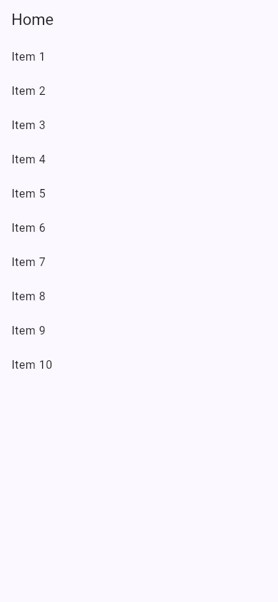
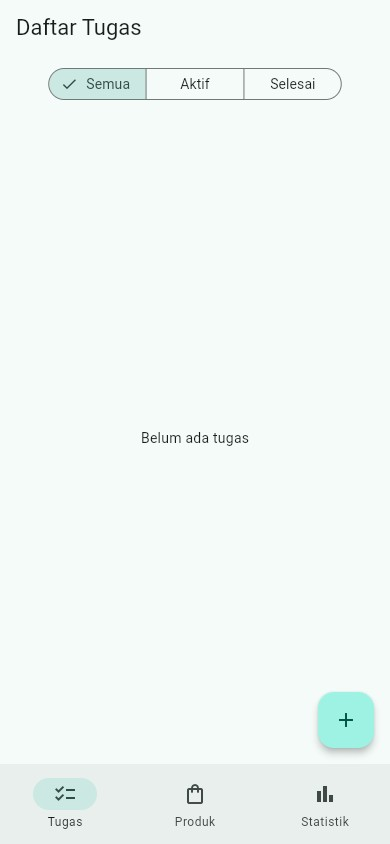
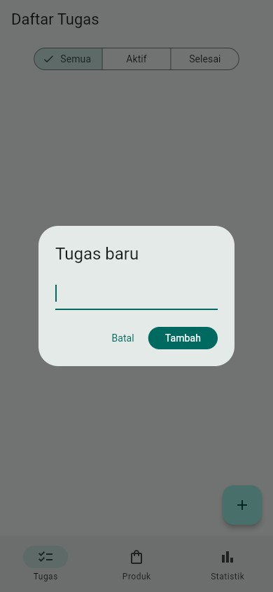

# Minggu 3 — Navigasi GoRouter & State Riverpod

Menggabungkan navigasi deklaratif (**GoRouter**) dengan state management
(**Riverpod**), ditutup simulasi data asinkron lewat `AsyncValue`.

**M.Adhitya Yusuf Al-Ayyubi · NIM 244107020045 · TI-2H**

## Peta isi folder

```text
03-week-3-navigation-state-management/
├── week3_navigation/             # Project Praktikum 1 (lihat README-nya)
│   └── README.md
├── week3_todo/                   # Project Praktikum 2 & 3 + AI Challenge
│   └── README.md
├── test/                         # Salinan test final (untuk portofolio)
│   ├── todo_provider_test.dart   # Unit test notifier + filter
│   ├── stats_provider_test.dart  # Unit test sukses & gagal
│   └── widget_test.dart          # Widget test tambah tugas & navigasi
├── docs/
│   └── ai-challenge.md           # Prompt, output AI, perbaikan, hasil test
├── screenshots/
└── README.md
```

> Kode jalan ada di `week3_navigation/` dan `week3_todo/` lokal (tidak
> di-push, hanya README-nya). Folder `test/` menyalin test final
> `week3_todo/` untuk dokumentasi.

Tiap project punya README sendiri:

- `week3_navigation/` — Praktikum 1 (navigasi GoRouter): `lib/` (`main.dart`,
  `pages/home_page.dart`, `pages/detail_page.dart`) + `test/`. Detail di
  [`week3_navigation/README.md`](week3_navigation/README.md).
- `week3_todo/` — Praktikum 2 & 3 + AI Challenge (ToDo + Riverpod): `lib/`
  (`main.dart`, `pages/`, `providers/`, `widgets/`) + `test/`. Detail di
  [`week3_todo/README.md`](week3_todo/README.md).

## Praktikum 1 — Daftar + detail GoRouter

Project `week3_navigation` menampilkan daftar 10 item. Menekan item membuka
`/detail/:id` lewat path parameter, dan path detail bisa diakses langsung
tanpa lewat Home.

**Home.**


**Detail.**


## Praktikum 2 — ToDo dengan Riverpod

State daftar tugas disimpan di `TodoListNotifier` dan dibaca UI lewat
`ref.watch`. Tiap perubahan membuat list baru (immutable), dan callback
memakai `ref.read(...notifier)`.

**Daftar tugas.**


**Dialog tambah.**


Yang bisa dilakukan aplikasi: navigasi `/` (daftar tugas), `/produk`, dan
`/stats` lewat `NavigationBar` tanpa kehilangan state; tambah, tandai
selesai, dan hapus tugas; filter Semua/Aktif/Selesai dari provider turunan.

## Praktikum 3 — AsyncValue + AI Challenge

Halaman `StatsPage` memakai `AsyncNotifier` yang mensimulasikan request
(delay 2 detik, gagal ±30%). Semua kondisi ditangani `AsyncValue.when`:

- **loading** — spinner + label "Memuat statistik..."
- **error** — pesan gagal + tombol **Coba lagi** (`ref.invalidate`)
- **success** — panel cincin persentase + `ListView` tiga baris
  (Total, Selesai, Belum selesai)
- **empty** — belum ada tugas: pesan + tombol ke tab Tugas

Statistik dihitung dari daftar tugas sebenarnya (bukan angka hardcoded)
lewat model `Stats` di `providers/stats_provider.dart`. Prompt, output awal
AI, perbaikan, dan hasil test ada di
[`docs/ai-challenge.md`](docs/ai-challenge.md).

## Yang saya refactor

- **`TodoTile`** jadi widget tersendiri di `lib/widgets/`.
- **Logika filter** jadi `filteredTodosProvider` — `Provider` turunan yang
  membaca `todoListProvider` dan `todoFilterProvider`.
- **Integrasi GoRouter**: `/` daftar tugas, `/produk` produk, `/stats`
  statistik, dengan `NavigationBar` untuk berpindah.

## Bukti uji

```bash
flutter test
```

```text
00:00 +0: statistik sukses menghitung total, selesai, dan sisa
00:00 +1: add, toggle, dan remove menghasilkan state baru
00:00 +2: filteredTodosProvider mengikuti filter
00:00 +3: menambah tugas baru
00:00 +4: berpindah ke halaman statistik lewat GoRouter
00:00 +5: statistik gagal memunculkan AsyncError
00:01 +6: All tests passed!
```

Analisis statis: `flutter analyze` → No issues found.
(`week3_navigation/`: 2 test lulus, analyze bersih.)

## Menjalankan

```bash
cd week3_todo
flutter pub get
flutter run -d chrome
```

Aplikasi membuka tab **Tugas** lebih dulu; tab **Tugas**, **Produk**, dan
**Statistik** tersedia lewat `NavigationBar` bawah.

## Hasil verifikasi AI saya

- State diubah immutable — `add`/`toggle`/`remove` selalu membuat list baru.
- `ref.watch` di `build`, `ref.read` di callback — tidak ada `watch` di callback.
- Semua kondisi AsyncValue ditangani — loading, error, success (+ empty).
- Provider bertipe eksplisit, tidak duplikat — `NotifierProvider` /
  `AsyncNotifierProvider`.
- Tanpa API Riverpod lama — no `StateProvider`/`StateNotifierProvider`.
- `flutter analyze` dan `flutter test` lolos — bersih, 6 test lulus.

## Refleksi

**Kapan `setState` cukup, kapan Riverpod?**
`setState` cukup untuk state lokal satu widget (isi dialog, toggle tema).
Riverpod saya pakai saat state dibagi antar halaman — daftar tugas tampil di
tab Tugas tapi dihitung di tab Statistik — atau harus hidup saat widgetnya
tidak tampil.

**`context.go` vs `context.push`?**
`go` mengganti stack (cocok untuk redirect dan pindah tab), `push` menumpuk
halaman sehingga tombol back kembali ke sebelumnya. Di `NavigationBar` saya
pakai `goBranch` (semantik `go`) agar tab tidak menumpuk.

**Mengapa `AsyncValue` lebih aman dari tiga boolean?**
Tiga boolean bisa berada di kombinasi mustahil (loading + error bersamaan).
`AsyncValue` satu tipe dengan kondisi saling eksklusif, dan
`AsyncValue.guard` mengubah exception menjadi `AsyncError` tanpa `try/catch`
bertebaran.

**Bagian hasil AI yang saya perbaiki?**
`Random`/`delay`/`failureRate` di-inject agar test deterministik; auto-retry
Riverpod 3 dimatikan (`retry: (...) => null`) supaya error bertahan dan
retry manual; operasi todo berbasis objek (bukan index) agar benar saat
filter aktif; provider mengembalikan model `Stats`, bukan `List<String>`.

## Checklist saya

- [x] Navigasi bekerja: pindah halaman, back, dan akses path detail langsung.
- [x] `ProviderScope` di root; state ToDo hidup saat pindah halaman.
- [x] UI `AsyncValue` menangani loading, error, dan success.
- [x] `flutter analyze` tanpa issue dan semua test lulus.
- [x] Hasil AI terdokumentasi di `docs/`.
