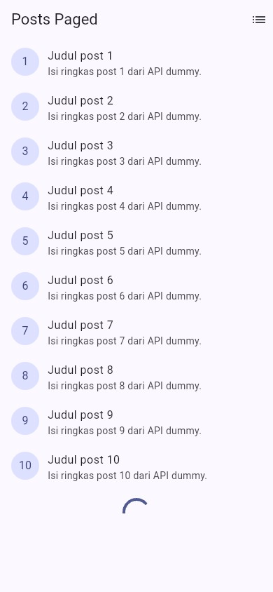
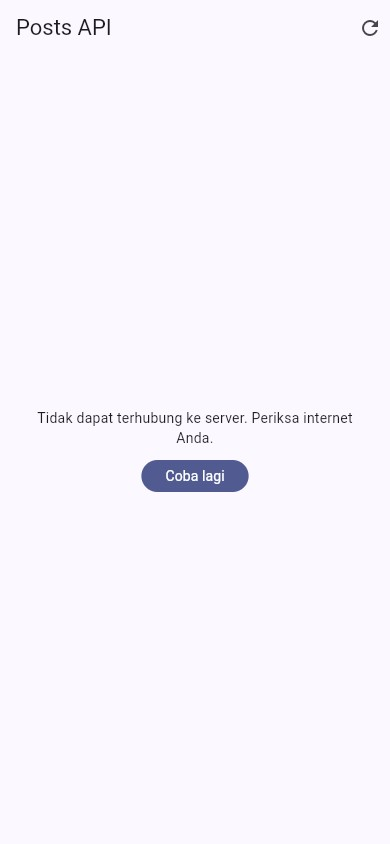
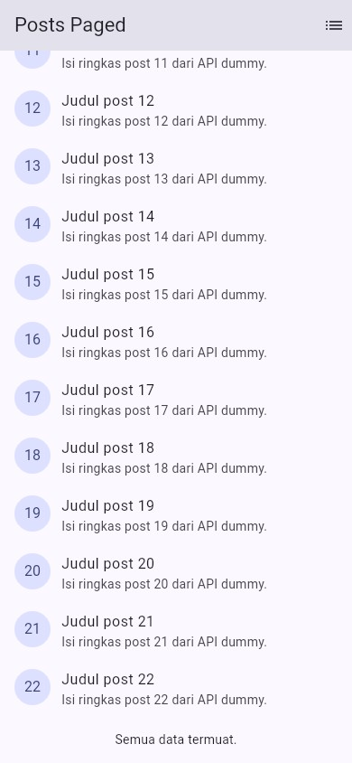
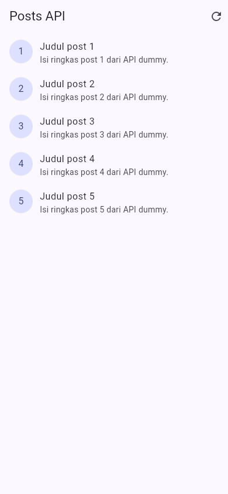
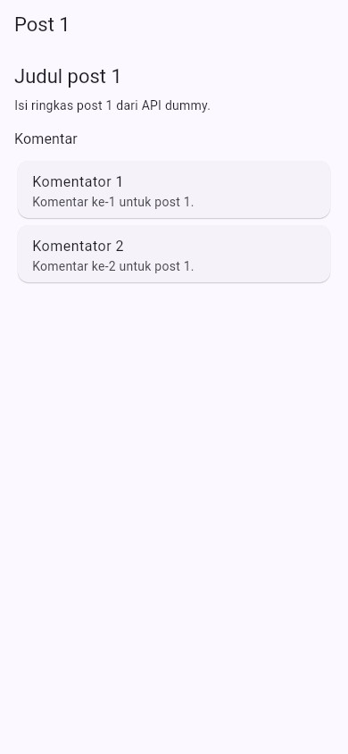
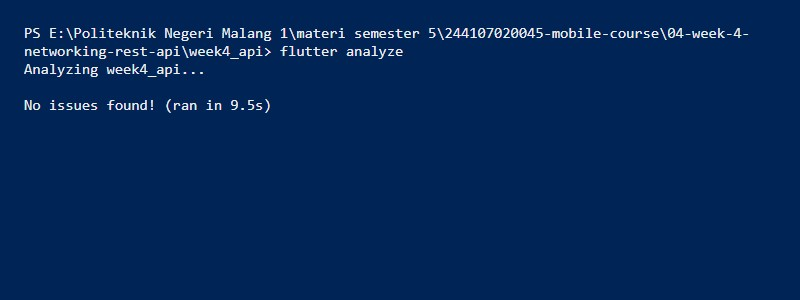
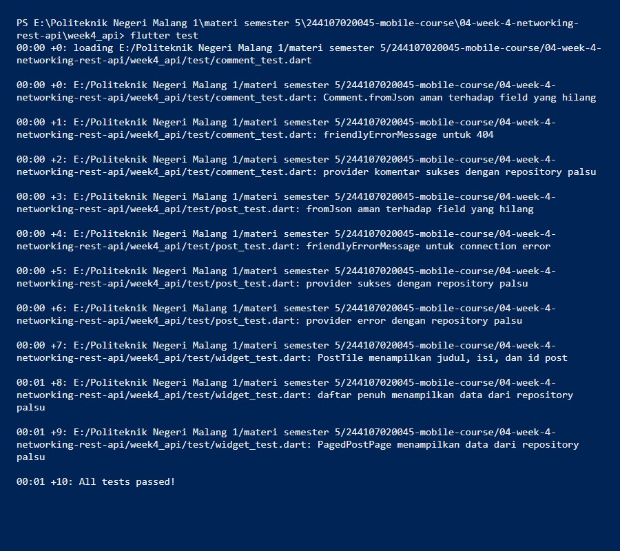

# Minggu 4 — Networking & REST API

Minggu ini saya ngambil data dari REST API publik, dipetakan ke model Dart
yang aman null, terus ditampilin lewat repository + Riverpod. Lengkap sama
loading, error, empty, success, sampai infinite scroll.

**M.Adhitya Yusuf Al-Ayyubi · NIM 244107020045 · TI-2H**

## Gambaran aplikasi

Klien HTTP terpusat (`dio`: `baseUrl`, timeout 10 detik, `LogInterceptor`).
Model `Post` dan `Comment` dengan `fromJson` aman null. `PostRepository`
(`fetchPosts`, `fetchPost`, `fetchPostsPage`) dan `CommentRepository`
(`fetchComments`) jadi satu-satunya pintu ke API. Halaman daftar penuh
(`/simple`) punya keempat state; halaman paginated (`/`) infinite scroll 10
item per halaman; halaman detail (`/post/:id`) menampilkan judul, isi, dan
komentar dari `GET /comments?postId={id}`. Error teknis dipetakan ke pesan
ramah (timeout, connection error, 404, 5xx). 10 test lulus tanpa HTTP
sungguhan (repository palsu).

**Stack:** Flutter 3.47 (Dart 3.13) · `dio` ^5.11 · `flutter_riverpod` ^3 ·
`go_router` ^18 · `flutter_test`.

## Isi folder

```text
04-week-4-networking-rest-api/
├── week4_api/                 # Project Flutter yang dapat dijalankan
│   ├── lib/
│   │   ├── main.dart          # ProviderScope + GoRouter (/ , /simple, /post/:id)
│   │   ├── data/
│   │   │   ├── api_client.dart          # createDio() terpusat
│   │   │   ├── providers.dart           # dioProvider, repository, notifier
│   │   │   ├── paged_posts.dart         # PagedPostsState + notifier
│   │   │   ├── network_errors.dart      # friendlyErrorMessage
│   │   │   ├── preview_fakes.dart       # Fakes khusus screenshot (?demo=)
│   │   │   ├── models/ (post.dart, comment.dart)
│   │   │   └── repositories/ (post_repository.dart, comment_repository.dart)
│   │   ├── pages/ (post_list_page.dart, paged_post_page.dart, post_detail_page.dart)
│   │   └── widgets/post_tile.dart
│   └── test/
│       ├── post_test.dart     # fromJson, error mapping, provider sukses/gagal
│       ├── comment_test.dart  # Comment.fromJson + 404 + provider komentar
│       ├── widget_test.dart   # PostTile & PagedPostPage
│       └── fakes.dart         # repository palsu (tanpa HTTP)
├── lib/                       # Salinan kode final (untuk portofolio)
├── test/                      # Salinan test final (untuk portofolio)
├── docs/
│   └── ai-challenge.md        # Prompt, output AI, perbaikan, hasil test
├── screenshots/
└── README.md
```

> Yang bisa dijalankan ada di `week4_api/` (di-ignore Git).
> `lib/` dan `test/` adalah salinan final untuk portofolio.

## Cara kerja lapisan data

```text
UI (ConsumerWidget) --watch--> Provider (AsyncValue)
Provider --panggil--> Repository --pakai--> Dio --HTTP--> REST API
```

UI nggak pernah manggil Dio langsung. Repository yang ngubah exception
jaringan jadi kegagalan yang bermakna lewat `friendlyErrorMessage`, terus
provider ngekspos `AsyncValue` ke UI.

**Model aman null.** `Post`/`Comment` memakai cast defensif
`as String? ?? ''` dan `(as num?)?.toInt() ?? 0` supaya respons yang tidak
sesuai dokumentasi tidak meledak dengan
`type 'Null' is not a subtype`.

**Dio terpusat.** Semua konfigurasi di `lib/data/api_client.dart`.
`baseUrl` bisa ditimpa untuk menguji error:

```bash
flutter run --dart-define=API_BASE_URL=https://localhost:9/
```

## Tampilan tiap state

- **loading** — `CircularProgressIndicator`.
- **error** — pesan ramah + tombol **Coba lagi** (`ref.invalidate`).
- **empty** — "Belum ada data dari server." / "Semua data termuat."
- **success** — daftar `PostTile` dengan `RefreshIndicator`.

**Loading.**


**Success.**


**Error + tombol Coba lagi.**


**Empty.**


## Pagination

`ScrollController` memicu halaman berikut 200px sebelum ujung list. Guard
`if (state.isLoadingMore || !state.hasMore) return;` mencegah request ganda
dan berhenti saat data habis; data lama dipertahankan bila halaman berikut
gagal.

**Infinite scroll (halaman 1 → 2 → 3).**


**Daftar penuh (`/simple`).**


## Detail + komentar (AI Challenge)

`/post/:id` menampilkan judul dan isi lengkap. Dibuka dari daftar, datanya
dikirim lewat `extra`; dibuka langsung, `postDetailProvider` mengambil ulang
dari repository. Komentar dari `GET /comments?postId={id}`.



Prompt, output awal AI, verifikasi, dan perbaikan:
[`docs/ai-challenge.md`](docs/ai-challenge.md).

## Yang saya refactor

- **`PostTile`** jadi widget tersendiri di `lib/widgets/` supaya
  `ListView.builder` pendek dan mudah diuji.
- **`friendlyErrorMessage`** pindah ke `lib/data/network_errors.dart` agar
  dipakai ulang halaman paged, non-paged, dan detail.
- **Halaman detail** `/post/:id` menampilkan `title` + `body` lengkap dari
  list (`extra`) atau repository bila dibuka langsung.

## Bukti uji

```bash
cd week4_api
flutter analyze
flutter test
```

```text
Analyzing week4_api...
No issues found!

00:00 +0: Comment.fromJson aman terhadap field yang hilang
...
00:01 +10: All tests passed!
```

**Output analyze.**


**Output test.**


## Menjalankan

```bash
cd week4_api
flutter pub get
flutter run -d chrome
```

Aplikasi membuka **Posts Paged** (`/`). Ikon daftar di kanan atas membuka
daftar penuh (`/simple`); menekan post membuka detail (`/post/:id`).

## Hasil verifikasi AI saya

- UI nggak manggil Dio langsung: UI cuma `ref.watch` provider.
- `fromJson` aman null: `as String? ?? ''`, `(as num?)?.toInt() ?? 0`.
- Semua `DioExceptionType` dipetakan: timeout, connectionError, badResponse.
- `baseUrl`/timeout terpusat: `createDio()` di `api_client.dart`.
- Test nguji field hilang + edge case: field hilang, 404, sukses/gagal.
- `flutter analyze` dan `flutter test` lolos: bersih, 10 test lulus.

## Checklist saya

- [x] Semua akses data lewat repository + provider.
- [x] Empat state tampil benar: loading, error (+ retry), empty, success.
- [x] Pagination bertambah saat scroll, tanpa request ganda, ada akhir data.
- [x] `flutter analyze` tanpa issue dan semua test lulus.
- [x] Hasil AI terdokumentasi di `docs/`.

## Refleksi

**Mengapa UI dilarang memanggil Dio langsung?**
UI jadi sulit diuji (butuh jaringan sungguhan), sulit diganti sumber
datanya, dan pemetaan error tersebar di banyak widget. Lewat repository, UI
hanya bergantung pada provider dan bisa diuji dengan repository palsu.

**Kapan pagination client-side cukup, kapan server-side?**
Client-side cukup bila datanya kecil dan sudah dimuat sekaligus. Server-side
(`_page`/`_limit`) untuk data besar — hanya halaman yang dibutuhkan yang
dikirim sehingga memori hemat.

**Bagaimana exception jadi `AsyncError` tanpa try/catch di tiap widget?**
`AsyncNotifier.build` yang melempar otomatis diubah Riverpod menjadi
`AsyncError`. `try/catch` eksplisit tetap saya pakai di `refresh()` karena
state ditetapkan manual dan data lama ingin dipertahankan.

**Bagian hasil AI yang saya perbaiki?**
Provider komentar saya pindah ke data layer agar bisa di-unit-test; tipe
`Override` yang tidak publik saya ganti; import tak terpakai saya hapus;
route awal saya perbaiki agar URL browser (`/post/:id`) dihormati.
