# Minggu 5 — Penyimpanan Lokal & Offline-First

Minggu ini saya nyimpen preferensi di `SharedPreferences`, catatan di SQLite
(`sqflite`) lewat repository lokal + Riverpod, dengan pola **offline-first**:
cache-first read, dirty flag, dan antrean sinkronisasi.

**M.Adhitya Yusuf Al-Ayyubi · NIM 244107020045 · TI-2H**

## Gambaran aplikasi

`PrefsRepository` + `SharedPreferences` menyimpan tema gelap/terang dan waktu
terakhir dibuka. `NoteRepository` + Riverpod menyimpan CRUD catatan persisten
di SQLite, diurutkan `updated_at` terbaru. Tiap perubahan lokal ditandai
`dirty = 1`; tombol **Sync** menjalankan `syncNotes()` (hitung kotor →
simulasi upload → `markAllSynced()`), dan badge kembali nol setelah sukses.
`GET /posts` dibaca cache-first: cache lokal tampil seketika, refresh
jaringan jalan di background dan hasilnya disimpan ke `cached_posts`. Toggle
`forceOffline` membuat simulasi offline deterministik. Detail `/note/:id`
dibaca langsung dari repository lokal. 7 test lulus tanpa SQLite/HTTP
sungguhan.

**Stack:** Flutter 3.47 (Dart 3.13) · `flutter_riverpod` ^3 · `riverpod` ^3 ·
`shared_preferences` ^2 · `sqflite` ^2 + `path` · `dio` ^5 · `go_router` ^18 ·
`sqflite_common_ffi_web` (demo/screenshot web) · `flutter_test`.

## Isi folder

```text
05-week-5-local-storage-offline-first/
├── week5_offline_notes/        # Project Flutter yang dapat dijalankan
│   ├── lib/
│   │   ├── main.dart           # ProviderScope + GoRouter (/ , /settings, /posts, /note/:id)
│   │   ├── data/
│   │   │   ├── prefs.dart               # PrefsRepository (SharedPreferences)
│   │   │   ├── providers.dart           # provider Riverpod + AsyncNotifier
│   │   │   ├── sync.dart                # syncNotes + PostCacheStore
│   │   │   ├── api_client.dart          # createDio() terpusat
│   │   │   ├── network_errors.dart      # friendlyErrorMessage + OfflineException
│   │   │   ├── preview_fakes.dart       # fakes khusus screenshot (?demo=)
│   │   │   ├── local/
│   │   │   │   ├── db.dart              # openNotesDb() + skema
│   │   │   │   ├── note.dart            # model Note (dirty flag)
│   │   │   │   └── notes_database_factory.dart  # init factory web (ffi_web)
│   │   │   ├── models/post.dart
│   │   │   └── repositories/
│   │   │       ├── note_repository.dart # satu-satunya pintu ke tabel notes
│   │   │       └── post_repository.dart
│   │   ├── pages/ (notes_page.dart, settings_page.dart, posts_page.dart, note_detail_page.dart)
│   │   └── widgets/note_tile.dart       # NoteTile + DirtyBadge
│   └── test/
│       ├── note_test.dart      # model + provider dengan repository palsu
│       ├── widget_test.dart    # NoteTile
│       └── fakes.dart          # FakeNoteRepository (tanpa SQLite)
├── lib/                        # Salinan kode final (untuk portofolio)
├── test/                       # Salinan test final (untuk portofolio)
├── docs/
│   └── ai-challenge.md         # Prompt, output AI, verifikasi, keputusan final
├── screenshots/
└── README.md
```

> Yang bisa dijalankan ada di `week5_offline_notes/` (di-ignore Git).
> `lib/` dan `test/` adalah salinan final untuk portofolio.

## Cara kerja lapisan lokal

```text
UI (ConsumerWidget) --watch--> Provider (AsyncValue)
Provider --panggil--> LocalRepository --CRUD--> SQLite
LocalRepository --sync--> Remote (simulasi) --sukses--> dirty = 0
Cache: baca lokal dulu, refresh background, simpan
```

UI tidak menyentuh SQLite/SharedPreferences langsung. Repository mengubah
exception platform menjadi kegagalan yang bermakna, provider mengekspos
`AsyncValue` ke UI.

## Preferensi

`PrefsRepository` memusatkan `getDarkMode`, `setDarkMode`, `markOpenedNow`,
dan `getLastOpened`; `DarkModeNotifier` membungkusnya dalam
`AsyncNotifierProvider`.

**Tema terang.**
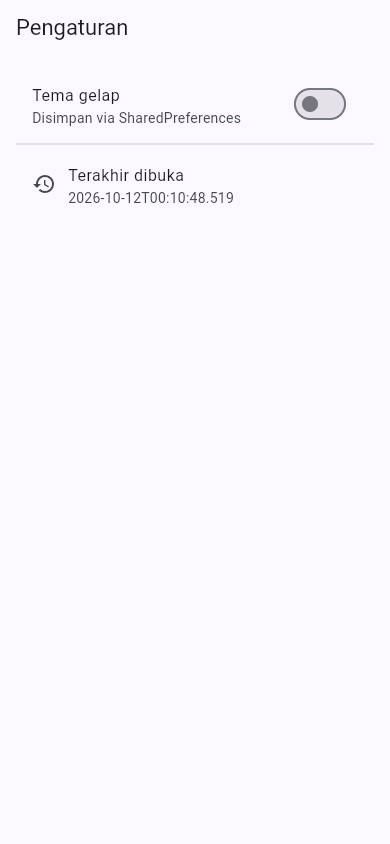

**Tema gelap.**
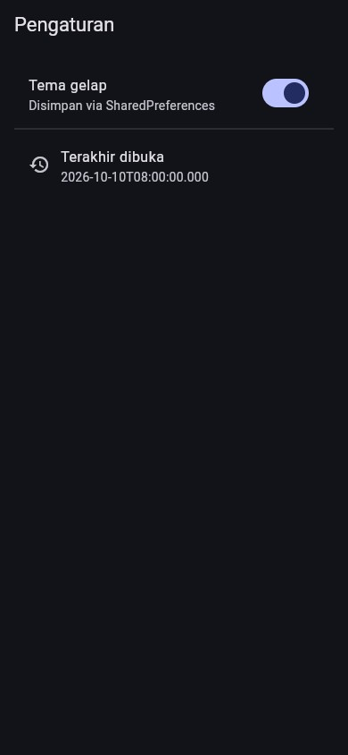

## Catatan offline

Catatan tersimpan di perangkat sehingga tetap berfungsi penuh dalam mode
pesawat. `NoteTile` menampilkan badge **Belum tersinkron** bila
`dirty == true`.

**Daftar + badge dirty.**
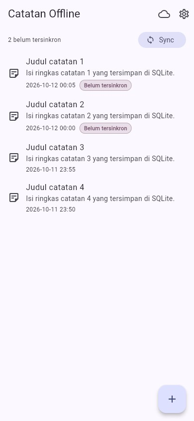

**Detail badge.**
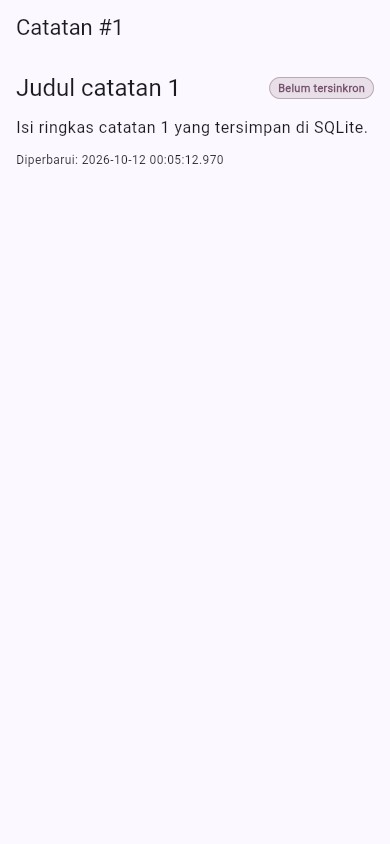

**Dialog tambah.**
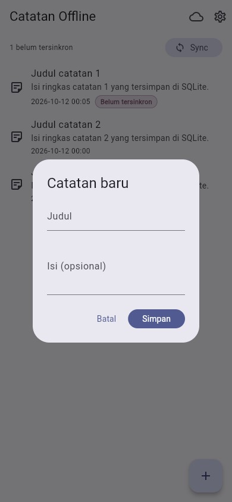

**Detail `/note/:id`** (dibaca dari repository lokal, bukan state list).
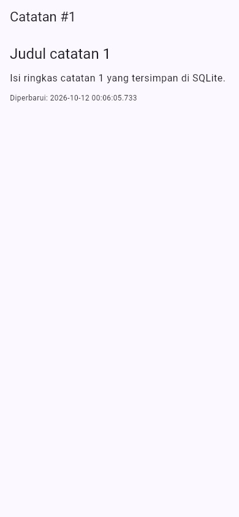

## Sinkronisasi

**Sebelum sync (2 dirty).**


**Sesudah sync (0 dirty).**
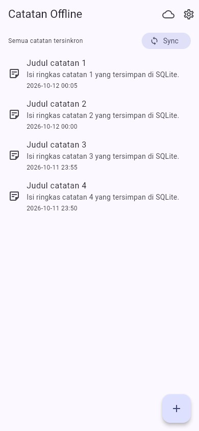

## Bukti mode pesawat

Catatan tetap tampil, bisa ditambah, badge tetap akurat tanpa jaringan.
Toggle `forceOffline` membuat simulasi deterministik; banner "Mode offline"
tampil di atas daftar.

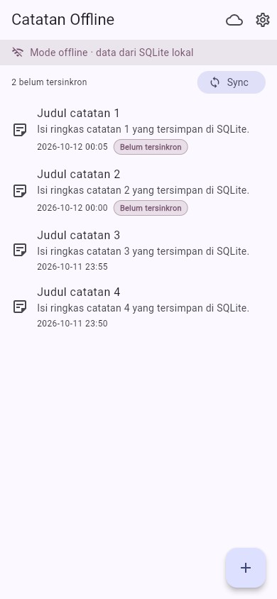

## Cache-first untuk data API

Halaman **Data API** menampilkan cache lokal seketika (`cached_posts`),
lalu refresh `GET /posts` di background. Bila refresh gagal, cache tetap
tampil dengan penanda error.

**Dari cache (offline).**
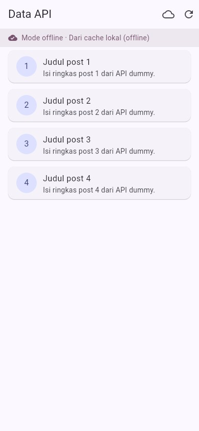

**Dari jaringan (tersimpan ke cache).**
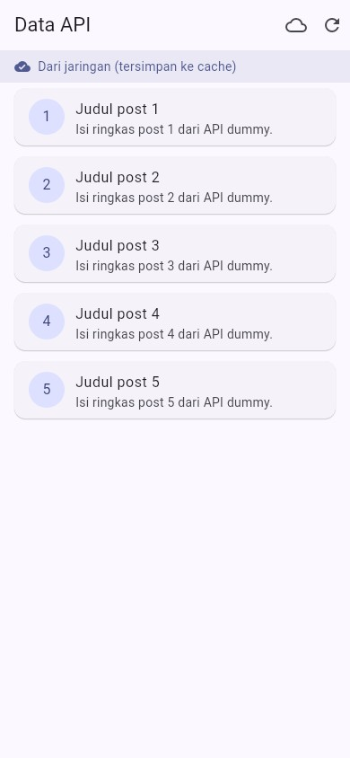

**Refresh gagal, cache tetap tampil.**
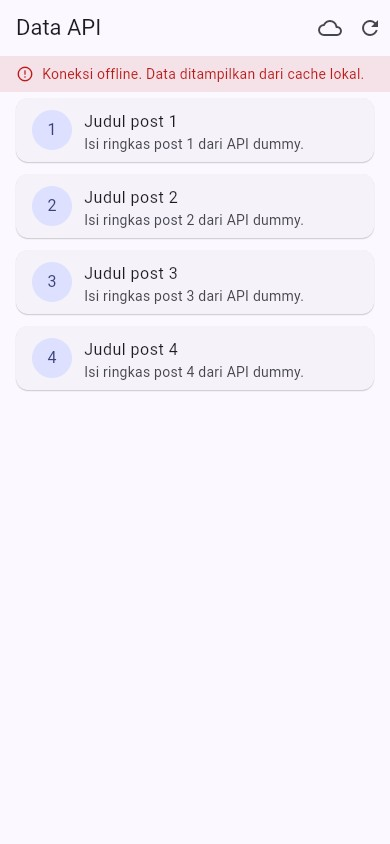

**Aturan konflik saya:** last-write-wins berdasarkan `updated_at`. Daftar
diurutkan `updated_at DESC`; saat sync, catatan terbaru menang. Eksplisit
agar sinkronisasi dua arah tidak menimpa data diam-diam.

## Yang saya refactor

- **`NoteTile`** jadi widget tersendiri di `lib/widgets/` dengan badge saat
  `dirty == true`.
- **`sync.dart`** menampung cache posts (`PostCacheStore`) dan `syncNotes`
  agar repository fokus pada CRUD.
- **Detail `/note/:id`** membaca dari repository lokal
  (`noteDetailProvider`), bukan state halaman list.

## Bukti uji

```bash
cd week5_offline_notes
flutter analyze
flutter test
```

```text
$ flutter analyze
Analyzing week5_offline_notes...
No issues found!

$ flutter test
00:00 +0: test/note_test.dart: fromMap aman terhadap field yang hilang
00:00 +1: test/note_test.dart: flag dirty bertahan pada serialisasi
00:00 +2: test/widget_test.dart: NoteTile menampilkan badge belum tersinkron
00:00 +3: test/note_test.dart: provider sukses dengan repository palsu
00:00 +4: test/note_test.dart: provider error dengan repository palsu
00:00 +5: test/note_test.dart: countDirty menghitung catatan belum tersinkron
00:00 +6: test/widget_test.dart: NoteTile tidak menampilkan badge saat sinkron
00:01 +7: All tests passed!
```

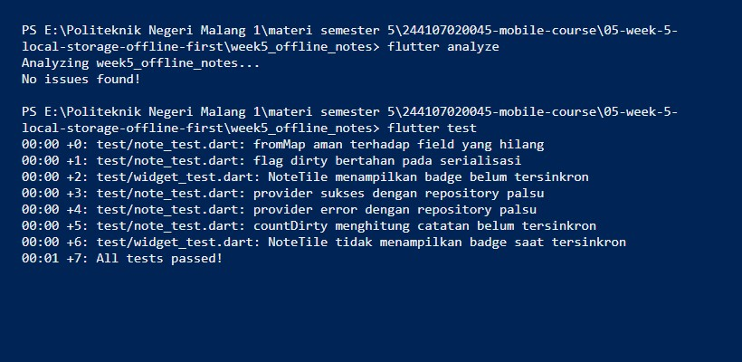

## Menjalankan

```bash
cd week5_offline_notes
flutter pub get
flutter run                 # Android/desktop
flutter run -d chrome       # Web (butuh sqflite_common_ffi_web)
```

Aplikasi membuka **Catatan Offline** (`/`). Ikon cloud membuka Data API
(`/posts`), ikon gerigi membuka Pengaturan (`/settings`), menekan catatan
membuka detail (`/note/:id`).

## Hasil verifikasi AI saya

- Daftar catatan nggak di SharedPreferences: AI pun nyaranin sqflite.
- Skema dukung antrean sync: saya tambah kolom `dirty` (AI cuma punya
  `updated_at`).
- Klaim "real-time" didukung: reaktivitas via Riverpod, bukan asumsi.
- Boilerplate masuk akal: `flutter pub add sqflite path` ringan.
- Test field hilang + repository palsu: `note_test.dart` + `FakeNoteRepository`.
- `flutter analyze` dan `flutter test` lolos: bersih, 7 test lulus.

## Checklist saya

- [x] Semua lewat repository + provider, tanpa akses langsung.
- [x] Fungsi penuh dalam mode pesawat: baca, tambah, hapus.
- [x] Badge akurat sebelum/sesudah sync; cache tampil tanpa internet.
- [x] `flutter analyze` tanpa issue dan semua test lulus.
- [x] Hasil AI terdokumentasi di `docs/`.

## Refleksi

**Mengapa daftar catatan tidak boleh di SharedPreferences?**
SharedPreferences hanya untuk primitif kecil. Koleksi sebagai satu string
JSON membuat query, update parsial, dan sinkronisasi rapuh dan lambat —
tanpa transaksi pula.

**Kapan cache-first cukup, kapan network-first?**
Cache-first untuk data yang boleh sedikit basi (daftar post, katalog).
Network-first untuk yang harus akurat saat itu juga (harga, saldo).

**Bagaimana dirty flag jadi antrean tanpa memblokir UI?**
Perubahan lokal langsung menulis ke SQLite + `dirty = 1`; UI selesai tanpa
menunggu jaringan. Sync jalan di background dan menandai bersih hanya
setelah sukses. Tabel outbox terpisah baru perlu saat operasi harus terkirim
berurutan beserta riwayat create/update/delete.

**Bagian hasil AI yang saya perbaiki?**
Kolom `dirty` untuk antrean sync, tabel `cached_posts` untuk cache-first,
dan test repository palsu.

Detail lengkap: [`docs/ai-challenge.md`](docs/ai-challenge.md).
