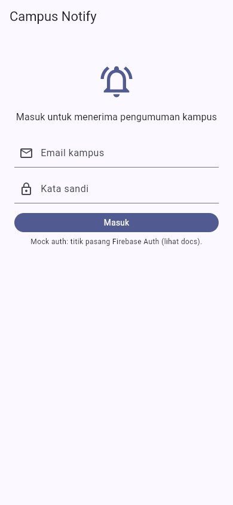
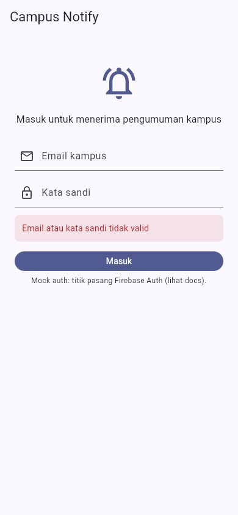
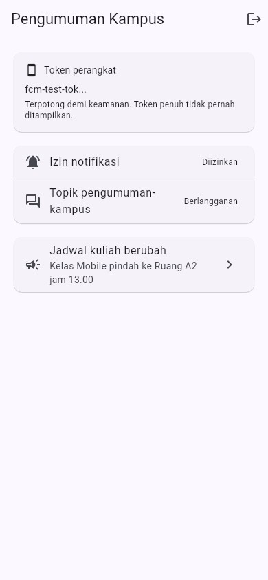
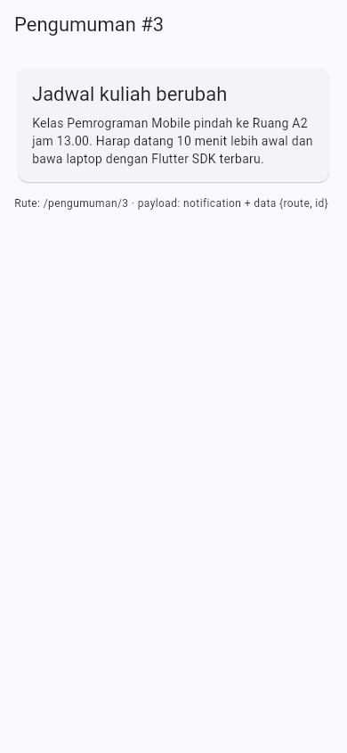
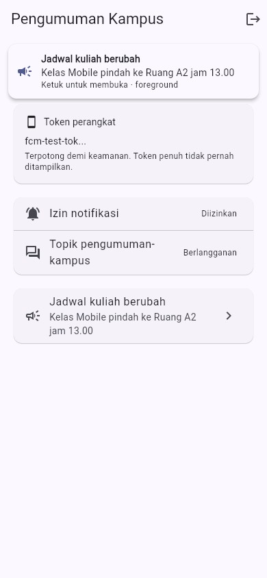
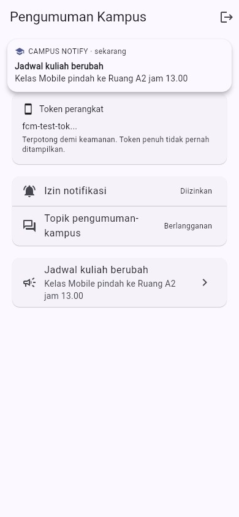
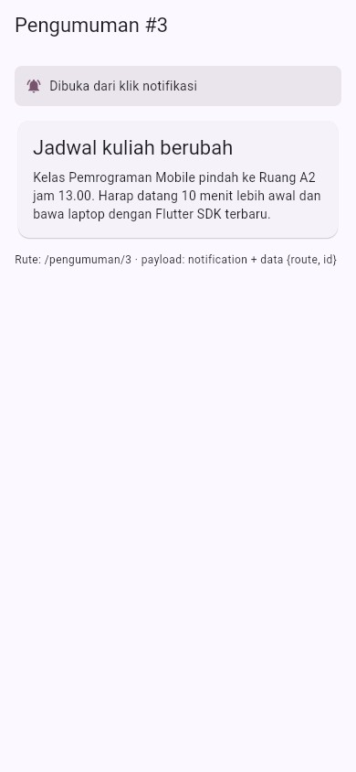
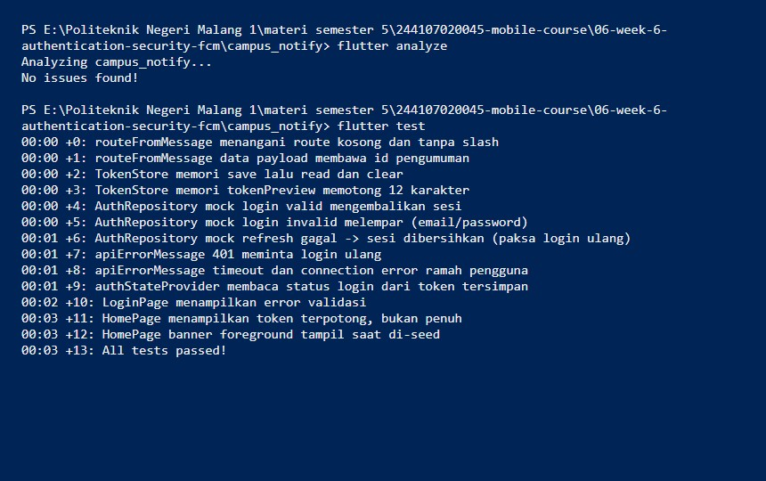

# Minggu 6 — Auth, Keamanan & FCM

Saya bikin **Campus Notification App**: login berpenjaga route, token aman
di secure storage, Dio yang refresh otomatis, dan notifikasi FCM dengan deep
link ke `/pengumuman/:id` di ketiga app state.

**M.Adhitya Yusuf Al-Ayyubi · NIM 244107020045 · TI-2H**

## Gambaran aplikasi

Login mock (siap diganti Firebase Auth) dengan guard: belum login selalu ke
`/login`. Access + refresh token hanya di `flutter_secure_storage`
(in-memory untuk test/demo) — tidak di SharedPreferences, kode, log, atau
screenshot. Dio menukar refresh **sekali** saat 401 lalu mengulang request;
bila refresh ikut mati, sesi dibersihkan dan pengguna dipaksa login ulang.
FCM: permission runtime, `getToken` + `onTokenRefresh` terkirim ke
`POST /devices`, langganan topik `pengumuman-kampus`. Payload selalu
gabungan `notification + data`; klik membuka `/pengumuman/:id` saat
foreground, background, maupun terminated. Token di UI selalu terpotong
(12 karakter + `...`). 13 test lulus tanpa Firebase/HTTP sungguhan.

**Stack:** Flutter 3.47 (Dart 3.13) · `flutter_riverpod` ^3 · `riverpod` ^3 ·
`go_router` ^18 · `dio` ^5 · `flutter_secure_storage` ^11 ·
`firebase_core` ^4 + `firebase_messaging` ^16 ·
`flutter_local_notifications` ^22 · `flutter_test`.

## Isi folder

```text
06-week-6-authentication-security-fcm/
├── campus_notify/              # Project Flutter yang dapat dijalankan
│   ├── lib/
│   │   ├── main.dart           # Firebase guarded init + GoRouter guard
│   │   ├── routes.dart         # Konstanta rute + topik + endpoint devices
│   │   ├── data/
│   │   │   ├── auth_repository.dart  # mock login/refresh (titik Firebase Auth)
│   │   │   ├── token_store.dart      # TokenStore + TokenBackend + tokenPreview
│   │   │   ├── api_client.dart       # buildApiClient (refresh-once interceptor)
│   │   │   └── api_errors.dart       # DioException -> pesan ramah
│   │   ├── providers/
│   │   │   ├── auth_provider.dart    # tokenStore/auth/api/push + AuthNotifier
│   │   │   └── push_providers.dart   # PushUiState (token, izin, topik, banner)
│   │   ├── messaging/
│   │   │   └── push_service.dart     # routeFromMessage, handler top-level,
│   │   │                             # PushService + Fake + Firebase impl
│   │   └── pages/ (login_page.dart, home_page.dart, announcement_page.dart)
│   └── test/
│       ├── auth_push_test.dart # route, token store, auth mock, error, provider
│       └── widget_test.dart    # login error, token terpotong, banner
├── lib/                        # Salinan kode final (untuk portofolio)
├── test/                       # Salinan test final (untuk portofolio)
├── docs/
│   └── ai-challenge.md         # Prompt, output AI, perbaikan, tabel 3 state
├── screenshots/
└── README.md
```

> Yang bisa dijalankan ada di `campus_notify/` (di-ignore Git).
> `lib/` dan `test/` adalah salinan final untuk portofolio.

## Alur token saya

```text
Login --> access (pendek) + refresh (panjang) tersimpan aman
Request API --header Bearer access--> 401 expired?
Ya --> tukar refresh --> access baru --> ulangi request sekali
Refresh ikut kedaluwarsa --> logout, kembali ke /login
```

Refresh token hanya lewat body POST HTTPS dan hanya di secure storage.

## Login

**Halaman login.**


**Validasi gagal.**


## Beranda

Token perangkat tampil terpotong, status izin, status langganan topik, dan
satu pengumuman yang bisa ditekan menuju detail.

**Beranda.**


**Bukti token + topik.**


**Bukti izin.**


**Detail `/pengumuman/3`** (tujuan deep link).


## Payload: notification vs data

- `notification` (`title` + `body`) — teks untuk manusia; Android
  menampilkannya otomatis saat background/terminated, foreground butuh manual.
- `data` (`route`, `id`) — selalu sampai ke handler; tidak ditampilkan
  otomatis.

Aplikasi ini selalu memakai gabungan keduanya.

## Uji tiga app state

| State | Harapan | Cara uji |
| :--- | :--- | :--- |
| Foreground | Banner lokal muncul, klik ke `/pengumuman/3` | Aplikasi terbuka, kirim dari console/backend |
| Background | Banner sistem muncul, klik ke rute benar | Tekan Home, kirim, klik banner |
| Terminated | Terbuka ke rute benar via `getInitialMessage` | Swipe-close, kirim, klik banner |

**Foreground (banner manual).**


**Background (banner sistem).**


**Terminated (deep link).**


> Firebase Console butuh project asli; bukti di atas memakai demo
> deterministik (`FakePushService` + seed state) yang mensimulasikan ketiga
> alur handler. Handler aslinya ada di `lib/messaging/push_service.dart`.

**Topik vs token:** broadcast (jadwal, libur) pakai topik
`pengumuman-kampus`; personal (nilai, tagihan) pakai token perangkat.

## Lifecycle token

1. Minta izin → 2. `getToken()` → kirim `POST /devices` →
3. `onTokenRefresh` memperbarui backend (token basi = notifikasi tak sampai) →
4. subscribe `pengumuman-kampus`.

## Yang saya refactor

- **Rute terpusat** di `lib/routes.dart` untuk FCM dan GoRouter.
- **`routeFromMessage`** fungsi murni — bisa diunit-test tanpa Firebase.
- **`api_errors.dart`** memetakan `DioException` agar UI hanya menerima pesan.

## Bukti uji

```bash
cd campus_notify
flutter analyze
flutter test
```

```text
$ flutter analyze
Analyzing campus_notify...
No issues found!

$ flutter test
00:00 +0: routeFromMessage menangani route kosong dan tanpa slash
...
00:03 +13: All tests passed!
```



## Menjalankan

```bash
cd campus_notify
flutter pub get
flutter run                 # Android (mock auth, tanpa Firebase)
flutter run -d chrome       # Web (FakePushService)
```

Untuk Firebase asli: buat project di Firebase Console, tambahkan aplikasi
Android sesuai `applicationId`, unduh `google-services.json` ke
`android/app/` (iOS: `GoogleService-Info.plist` + capability Push + APNs
key). `Firebase.initializeApp()` sudah dipanggil guarded di `main()`.

## Hasil verifikasi AI saya

- Background handler top-level + pragma: fungsi top-level, tanpa BuildContext.
- `onTokenRefresh` ke backend: saya perbaiki dari sekadar log jadi
  `POST /devices` terdokumentasi.
- Foreground manual: `showForegroundNotification` ada.
- Klik 3 state ke rute benar: tabel + screenshot 05/06/07.
- Tanpa hardcode/log token penuh: saya ganti `tokenPreview()` 12 karakter.
- Beda Android 13+ vs iOS: komentar di `FirebasePushService`.

## Checklist saya

- [x] Token hanya di secure storage.
- [x] 401 → refresh sekali → retry; refresh mati → login ulang.
- [x] Tiga state teruji; klik ke rute benar.
- [x] Topik untuk broadcast, token untuk personal.
- [x] `flutter analyze` bersih dan semua test lulus.
- [x] Hasil AI terdokumentasi di `docs/`.

## Refleksi

**Mengapa refresh token tidak boleh di SharedPreferences?**
Tidak terenkripsi; bila bocor, penyerang memperbarui sesi tanpa batas sampai
refresh dicabut server. Secure storage memakai Keychain/Keystore bawaan OS.

**Apa yang rusak bila `onTokenRefresh` diabaikan satu semester?**
Token basi menumpuk (reinstall, clear data, rotasi) sehingga pengumuman
penting tak sampai ke banyak perangkat.

**Kapan topik, kapan token?**
Topik untuk umum (jadwal berubah, libur); token untuk personal (nilai,
tagihan UKT).

**Bagian draf AI yang saya perbaiki?**
Token penuh di Debug (jadi preview), `onTokenRefresh` yang hanya log
(wajib kirim backend), API local-notification lama (sesuai v22), dan Firebase
yang diwajibkan (dibuat opsional/mock-first).

Detail lengkap: [`docs/ai-challenge.md`](docs/ai-challenge.md).
