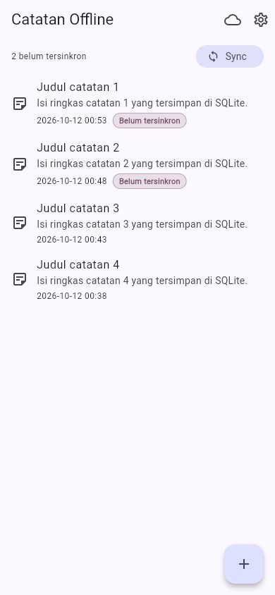
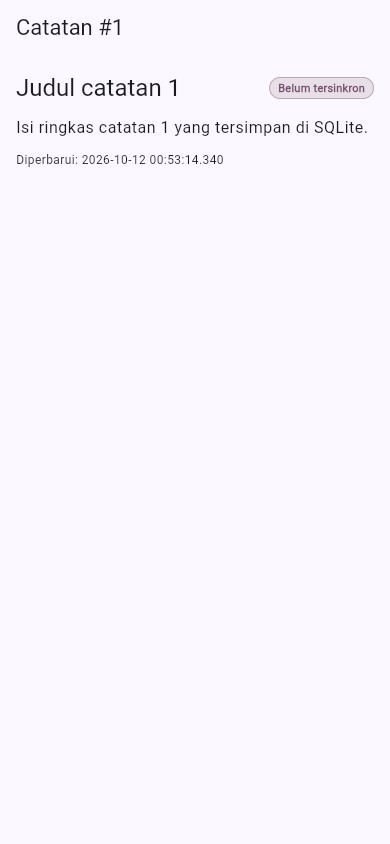
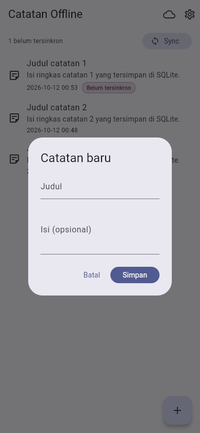
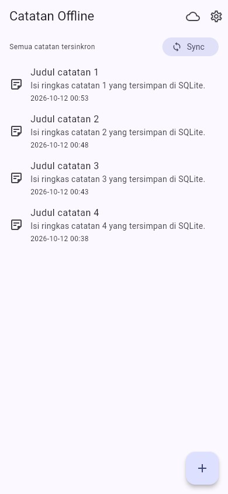
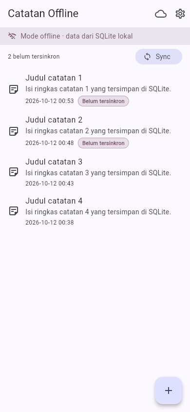
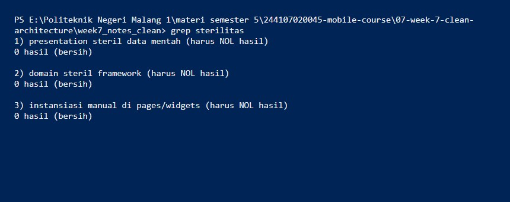
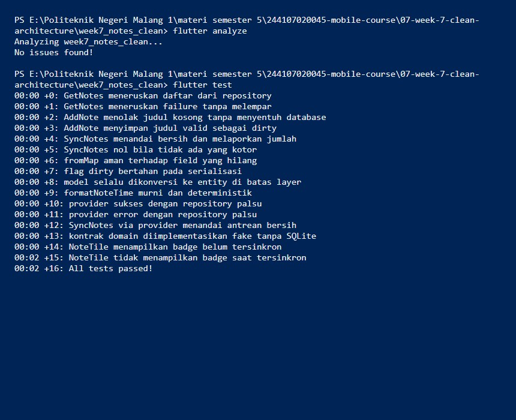

# Minggu 7 — Clean Architecture (Feature-First)

Refactor project **Minggu 5** (`week5_offline_notes`) menjadi struktur
feature-first Clean Architecture: domain / data / presentation terpisah, dengan
dependensi hanya mengarah ke dalam.

**M.Adhitya Yusuf Al-Ayyubi · NIM 244107020045 · TI-2H**

> Codelab ini **merefactor** project sebelumnya, bukan membuat dari nol.

## Tujuan

- Menjelaskan SOLID dan separation of concerns lewat kode Flutter.
- Membandingkan feature-first vs layer-first beserta trade-off-nya.
- Memisahkan tiga layer (presentation, domain, data) dengan aturan dependensi
  yang mengarah ke dalam.
- Membedakan entity vs model, serta peran repository, use case, dan DI.
- Merefactor fitur notes yang sudah berjalan menjadi feature-first.
- Menguji use case dengan repository palsu tanpa database/jaringan.

## Diagram layer + arah dependensi

```text
presentation  (widget, notifier, router)
      |
      |  bergantung ke
      v
domain        (entity, repository interface, use case, failure)
      ^
      |  diimplementasikan oleh
      |
data          (model, repository impl, Dio, SQLite, SharedPreferences)
```

**Aturan emas:** dependensi hanya ke dalam. `domain` tidak tahu apa pun
tentang Flutter, Dio, atau SQLite — makanya logika bisnis bisa diunit-test
murni.

## Gambaran hasil

- Fitur `notes` dipisah penuh: entity `Note` (murni), kontrak
  `NoteRepository` (interface), implementasi SQLite `NoteRepositoryImpl`,
  model `NoteModel` (satu-satunya tempat mapping), 3 use case
  (`GetNotes`, `AddNote`, `SyncNotes`), dan wiring DI di
  `notes_providers.dart`.
- Kegagalan diseragamkan jadi `Failure` (`LocalFailure`,
  `ValidationFailure`, `NetworkFailure`) memakai record Dart
  `({notes, failure})` — tidak ada exception mentah yang bocor ke UI.
- Preferensi (`SharedPreferences`) dan cache posts tetap berjalan di
  `lib/data` (bukan domain bisnis), dan sengaja **tidak** saya beri use
  case (anti over-engineering).
- `formatNoteTime` dipindah ke `core/format.dart` (murni, ada test).
- 16 test lulus (use case + model + provider + widget) tanpa SQLite/Dio.
- Tiga grep sterilitas nol hasil; `flutter analyze` bersih.

**Stack:** Flutter 3.47 (Dart 3.13) · `flutter_riverpod` ^3 · `riverpod` ^3 ·
`shared_preferences` ^2 · `sqflite` ^2 + `path` · `dio` ^5 · `go_router` ^18 ·
`sqflite_common_ffi_web` · `flutter_test`.

## Isi folder

```text
07-week-7-clean-architecture/
├── week7_notes_clean/           # Project Flutter yang dapat dijalankan
│   ├── lib/
│   │   ├── main.dart           # ProviderScope + GoRouter
│   │   ├── core/
│   │   │   ├── failures.dart   # Failure domain (murni Dart)
│   │   │   └── format.dart     # formatNoteTime (murni, diuji)
│   │   ├── data/               # prefs + cache posts (bukan domain bisnis)
│   │   │   ├── providers.dart, api_client.dart, post_cache.dart, ...
│   │   │   ├── local/db.dart   # skema SQLite
│   │   │   └── models/post.dart, repositories/post_repository.dart
│   │   ├── features/notes/
│   │   │   ├── domain/
│   │   │   │   ├── entities/note.dart            # entity murni
│   │   │   │   ├── repositories/note_repository.dart  # INTERFACE + Failure record
│   │   │   │   └── usecases/{get_notes,add_note,sync_notes}.dart
│   │   │   ├── data/
│   │   │   │   ├── models/note_model.dart          # mapping + toEntity
│   │   │   │   └── repositories/note_repository_impl.dart  # SQLite
│   │   │   └── presentation/
│   │   │       ├── providers/notes_providers.dart  # notifier + DI
│   │   │       ├── pages/{notes_page,note_detail_page}.dart
│   │   │       └── widgets/note_tile.dart
│   │   └── pages/{posts_page,settings_page}.dart  # fitur non-dibrefactor
│   └── test/ (get_notes_test.dart, note_test.dart, widget_test.dart, fakes.dart)
├── lib/                        # Salinan kode final (untuk portofolio)
├── test/                       # Salinan test final (untuk portofolio)
├── docs/
│   └── ai-challenge.md         # Prompt, output AI, usulan-vs-keputusan, grep
├── screenshots/
└── README.md
```

> Yang bisa dijalankan ada di `week7_notes_clean/` (di-ignore Git).
> `lib/` dan `test/` adalah salinan final untuk portofolio.

## Feature-first vs layer-first (keputusan saya)

| Struktur | Bentuk | Kapan dipakai |
| :--- | :--- | :--- |
| `feature-first` | `lib/features/notes/{data,domain,presentation}` | Project multi-fitur — satu fitur bisa dipahami/dihapus tanpa menyentuh fitur lain |
| `layer-first` | `lib/{data,domain,presentation}` global | Project kecil satu fitur; cepat tapi berantakan saat fitur bertambah |

Saya pilih **feature-first** karena aplikasi ini punya beberapa fitur (notes,
prefs, cache posts) dan refactor ini harus membuat fitur notes bisa
dibahas/diuji terpisah.

## Catatan keptuhan (before → after)

UI sengaja **tidak** berubah — bukti screenshot before (Week 5) dan after
(Week 7) identik. Yang berubah adalah arah panah dependensi:

**Daftar catatan + badge dirty (identik dengan Week 5).**


**Badge dirty di detail.**


**Dialog tambah.**


**Sesudah sync (0 dirty).**


**Mode offline.**


**Detail catatan.**


## Bukti dependency rule (tiga grep)

Semua **nol hasil** — terbukti lewat grep, bukan Reading sekilas:

```text
1) presentation steril data mentah        0 hasil
2) domain steril framework                0 hasil
3) instansiasi manual di pages/widgets     0 hasil
```

**Screenshot bukti grep.**


## Refactoring Challenge (yang saya kerjakan)

1. **Pola sama ke fitur kedua:** prefs/posts saya biarkan di `lib/data`
   karena bukan domain bisnis (lihat Refleksi); coupling cache ke fitur
   notes saya putuskan.
2. **`core/format.dart`:** `formatNoteTime` (murni) menggantikan formatting
   tanggal inline di `NoteTile`; ada unit test.
3. **Failure sebelum UI:** exception SQLite/Dio diubah jadi `Failure`
   (message ramah) di batas data; UI hanya menerima `message`.

## Bukti uji

```bash
cd week7_notes_clean
flutter analyze
flutter test
```

```text
$ flutter analyze
Analyzing week7_notes_clean...
No issues found!

$ flutter test
00:00 +0: GetNotes meneruskan daftar dari repository
...
00:02 +16: All tests passed!
```



## Menjalankan

```bash
cd week7_notes_clean
flutter pub get
flutter run                 # Android/desktop
flutter run -d chrome       # Web (demo deterministik)
```

## Hasil verifikasi AI saya

- Interface repository di `domain`, implementasi di `data` — ✅ diterima.
- Domain bebas Flutter/Dio/SQLite — ✅ **dibuktikan grep**, bukan Reading.
- Use case per CRUD satu-baris — ❌ saya **tolak** (over-engineering).
- Entity bebas mapping — ✅ (`toMap/fromMap` hanya di `NoteModel`).
- Wiring terpusat di provider — ✅ (`notes_providers.dart`).
- `flutter analyze` + `flutter test` — ✅ bersih, 16 test lulus.

Detail lengkap: [`docs/ai-challenge.md`](docs/ai-challenge.md).

## Checklist saya

- [x] Tiga grep sterilitas nol hasil.
- [x] Interface di domain, implementasi di data, mapping hanya di model.
- [x] Widget tidak menginstansiasi repository; semua lewat provider.
- [x] Aplikasi berjalan identik sebelum/sesudah refactor (screenshot).
- [x] `flutter analyze` bersih dan semua test lulus.
- [x] Hasil AI diverifikasi dan terdokumentasi di `docs/`.

## Refleksi

**Mengapa interface repository harus di domain, bukan data?**
Domain menyatakan kebutuhan bisnis (saya butuh daftar catatan), sedangkan
lapisan data yang mewujudkannya. Kalau interface ikut pindah ke data, domain
jadi bergantung pada detail implementasi seperti SQLite atau Dio, sehingga
logika bisnis tidak bisa diuji tanpa database. Arah panah yang terbalik
merusak batas antar layer.

**Kapan use case benar-benar dibutuhkan?**
Ketika operasi punya aturan bisnis (validasi, gating, menggabungkan
repository) atau dipakai lintas tempat. CRUD satu-baris yang tanpa aturan
cukup repository lalu notifier. `SyncNotes` dan `AddNote` punya aturan;
`deleteNote` dan `findNote` tidak, jadi tidak saya beri use case.

**Biaya over-engineering?**
Untuk tim kecil, use case per CRUD menambah file tanpa menambah nilai:
lebih banyak boilerplate untuk disimpan, dibaca, dan dites tanpa kasus
dinamis. Biayanya sepadan saat logika benar-benar tumbuh, misalnya sinkronisasi
dua arah atau validasi berlapis, seperti yang saya lakukan di `SyncNotes`.

**Bagian usulan AI yang saya tolak?**
Use case untuk tiap CRUD (over-engineering), refactor dua fitur penuh
(prefs/posts bukan domain bisnis), dan injeksi lewat `get_it` (Riverpod
sudah cukup). Saya juga menemukan coupling tersembunyi: cache posts
mengambil `openDb` dari repository notes, dan sekarang sudah dilepas.