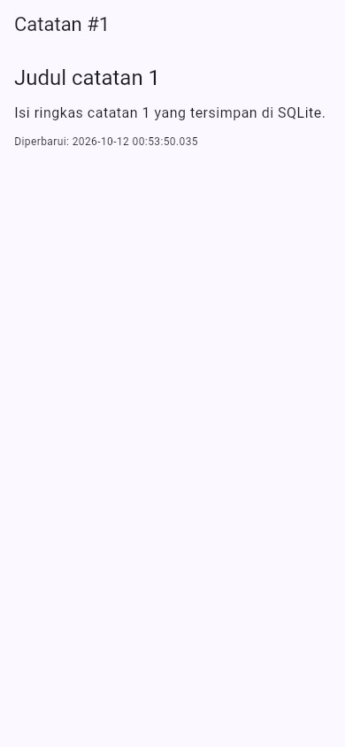
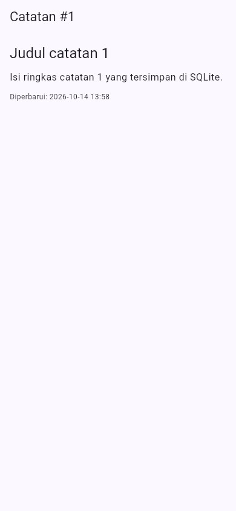
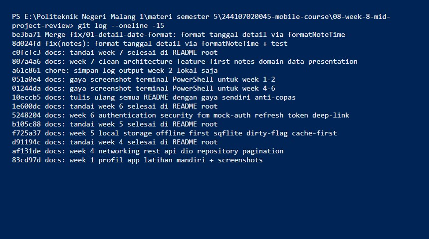
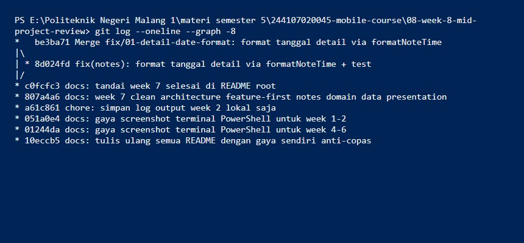
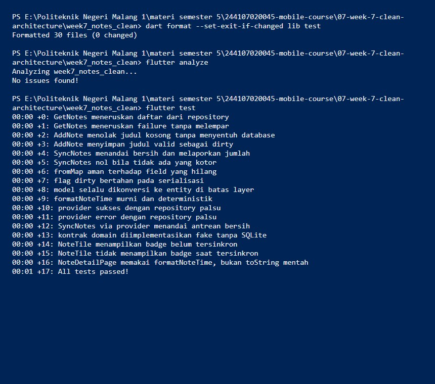
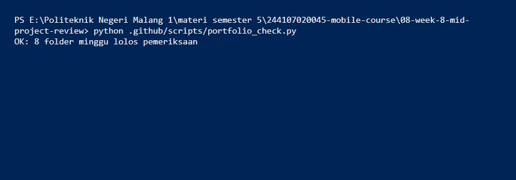

# Minggu 8 — Mid Project Review & Code Review

Review tengah semester atas project Minggu 5-7: GitFlow, issue + PR kecil,
review AI terverifikasi, tiga mesin hijau, dan CI penolak PR kotor.

**M.Adhitya Yusuf Al-Ayyubi · NIM 244107020045 · TI-2H**

> Minggu ini **mereview project yang sudah ada**, bukan membuat dari nol.

## Status paruh semester

Fondasi paruh pertama selesai dan terbukti: struktur feature-first (Week 7,
tiga grep sterilitas nol hasil), `flutter analyze` bersih, `dart format`
rapi, `flutter test` hijau (17 test), 1 PR kecil di-merge via review, dan
tiap folder minggu punya README + screenshot + cara menjalankan. Yang
dinilai bukan banyaknya fitur, melainkan fondasi yang bisa dipercaya untuk
paruh kedua — dan fondasi itu ada.

**Stack yang direview:** Flutter 3.47 (Dart 3.13) · `flutter_riverpod` ^3 ·
`sqflite` ^2 · `dio` ^5 · `go_router` ^18 · `flutter_test` · Git + GitHub
Actions (CI portofolio).

## Peta issue / PR

| Artefak | Isi | Status |
| :--- | :--- | :--- |
| Branch `develop` | Integrasi, dibuat sekali dari `main` | ✅ Ter-push |
| Issue `fix/01` | Tanggal detail memakai `toString()` mentah | ✅ Ditutup via merge |
| Branch `fix/01-detail-date-format` | 1 commit kecil (28+/1-) | ✅ Ter-push |
| Merge `--no-ff` ke `develop` | Review AI + 3 mesin hijau dulu | ✅ Ter-push |
| PR GitHub (web) | `fix/01` → `develop`, template lengkap | ⏳ Manual (tanpa `gh` CLI di mesin ini; branch siap Compare & PR) |

**Sebelum (Week 7):** baris tanggal memuat detik.


**Sesudah (PR ini):** baris tanggal memakai `formatNoteTime` (tanpa detik).


## Audit riwayat (ringkas)

18 commit semuanya langsung ke `main`, tanpa branch fitur, tanpa `develop`.
Pesan sudah konvensional (`tipe(scope): deskripsi`), 3 di antaranya saya
perketat di `docs/review-checklist.md` sebagai acuan gaya ke depan (riwayat
ter-push tidak ditulis ulang).

**Log + branch sesudah perbaikan.**



Detail audit: [`docs/review-checklist.md`](docs/review-checklist.md).

## Review AI vs keputusan (ringkas)

5 temuan AI atas diff PR: **2 diterima** (1 jadi komentar kode presisi menit),
**2 ditolak dengan bukti** (grep membuktikan tidak ada tanggal di
posts/settings; `initial` adalah desain sengaja), 1 sebagian. Pelajaran:
review AI yang diterima mentah menambah kode tanpa nilai.

Detail + bukti tiap temuan: [`docs/ai-review-vs-keputusan.md`](docs/ai-review-vs-keputusan.md).

## Tiga mesin hijau

```text
$ dart format --set-exit-if-changed lib test
Formatted 30 files (0 changed)

$ flutter analyze
Analyzing week7_notes_clean...
No issues found!

$ flutter test
00:01 +17: All tests passed!
```



Perintah `dart format` sempat menemukan 15 file belum rapi (warisan Week 7);
sudah dirapikan sebelum PR diminta review — sesuai urutan jobsheet
(error → warning → info, mesin dulu baru manusia).

## CI penolak PR kotor

Root repo ini portofolio (bukan satu package Flutter), jadi CI standar
(`flutter analyze` di root) tidak berlaku. Adaptasi yang jujur:
`.github/workflows/ci.yml` menjalankan `portfolio_check.py` di tiap PR —
menolak README tanpa section wajib, gambar yang dirujuk tapi hilang, dan
docs AI yang hilang.



Contoh nyata gunanya: checker ini menemukan README Week 1 belum punya
section Menjalankan — langsung saya perbaiki di minggu ini.

## Cara menjalankan (yang direview)

```bash
cd 07-week-7-clean-architecture/week7_notes_clean
flutter pub get
flutter analyze        # harus: No issues found!
dart format --set-exit-if-changed lib test   # harus: 0 changed
flutter test           # harus: All tests passed! (17)
flutter run -d chrome
```

## Hasil verifikasi AI saya

- Temuan benar-benar ada — ✅ dibuktikan grep/test, bukan Reading.
- Usulan tidak melanggar dependency rule — ✅ dicek satu per satu.
- Bukan nitpick style — ❌ 1 temuan style (l10n) ditolak; style urusan formatter/CI.
- Minimal 2 temuan terbukti benar + 1 ditolak beralasan — ✅ (2 diterima, 2 ditolak).

## Checklist saya

- [x] Branch dari `develop`, PR kecil satu fitur, issue tertutup via merge.
- [x] Minimal 3 komentar review bermakna ditindaklanjuti (5 temuan → keputusan).
- [x] `flutter analyze` bersih, `dart format` rapi, `flutter test` hijau.
- [x] Tabel usulan AI vs keputusan final di `docs/`.

## Refleksi

**Apa beda LGTM buta dengan approve yang bertanggung jawab?**
LGTM buta menyetujui tanpa menarik kode, tanpa menjalankan, tanpa memahami
diff — risikonya bug lolos dengan stempel "sudah direview", dan kepercayaan
tim pada proses review runtuh. Approve bertanggung jawab berarti pull,
jalankan, uji manual, dan paham tiap baris yang disetujui. Buktinya di
minggu ini: 2 dari 5 temuan AI ternyata salah, dan itu hanya ketahuan karena
saya verifikasi, bukan karena AI-nya pintar.

**Kapan komentar wajib request changes, kapan cukup saran?**
Request changes untuk yang merusak kebenaran, arsitektur, atau test
(exception bocor, dependency rule jebol, kasus gagal tak teruji). Saran
cukup untuk preferensi (nama variabel, komentar tambahan) yang tidak
mengubah perilaku.

**Bagian review AI yang saya tolak?**
Tuduhan `initial` melewati testing (desain sengaja, path lain sudah
teruji), usulan `formatNoteTime` di posts/settings (grep: tidak ada tanggal
di sana), dan l10n untuk 1 string (over-engineering). Penolakan semuanya
berbasis bukti, tercatat di `docs/ai-review-vs-keputusan.md`.

**Satu hal konkret yang saya perbaiki?**
Komentar presisi menit di `formatNoteTime` — dampaknya: 6 bulan lagi (atau
anggota tim lain) tidak akan "memperbaiki" format ini menjadi berdetik
tanpa sadar memecahkan test deterministik.
